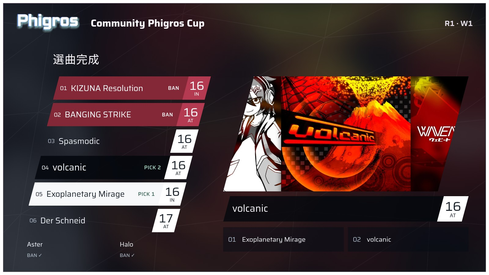
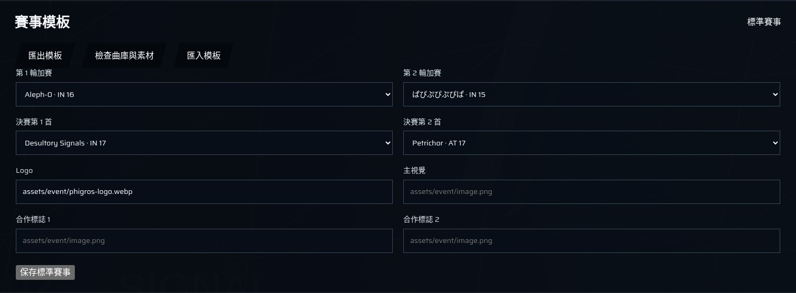
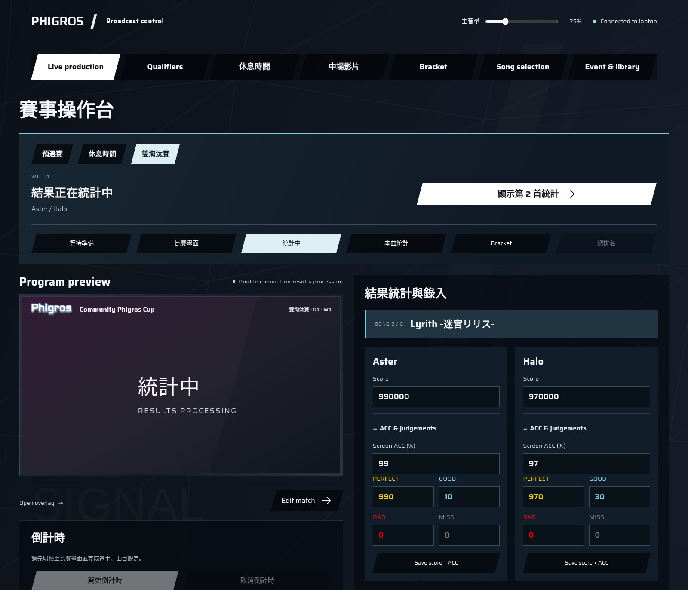
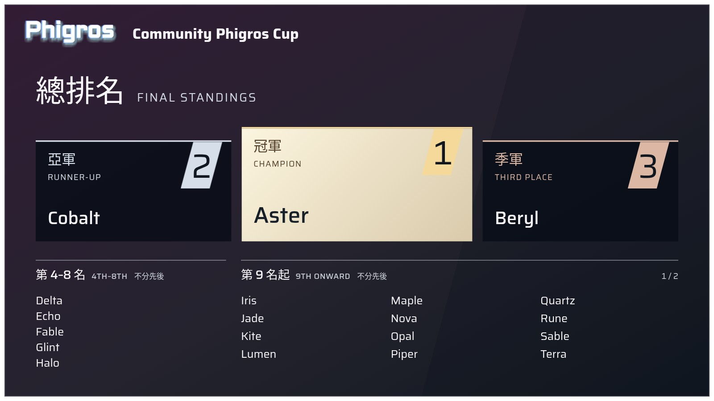

# Phigros Tournament Broadcast

Run Phigros qualifiers, an eight-player double-elimination bracket and OBS graphics from one local server.

[](https://github.com/VivoWalker/Phigros-Tournament-Boardcast/actions/workflows/test.yml)

**English** · [繁體中文](README.zh-TW.md) · [简体中文](README.zh-CN.md)



*Actual application screenshots with synthetic competitors. The operator interface currently combines English and Traditional Chinese.*

[Quick start](#quick-start) · [Run a tournament](#run-a-tournament) · [OBS setup](#obs-setup) · [Documentation](#documentation)

## What it does

- **Direct the broadcast:** move through waiting, song reveal, gameplay, processing, results, intermission and final standings from the production console.
- **Share the work:** separate main-control, scorekeeper and host panels, each with its own pairing code and permissions.
- **Run the competition:** three-song qualifiers, cutoff tiebreaks, six-candidate draws, player bans, two-song rounds and staged ACC decisions.
- **Reuse the setup:** configurable song library, qualifier/tiebreak/final charts, event branding and portable event templates.
- **Keep audio consistent:** shared master volume for previews, background music and videos; staff previews stay silent.
- **Operate over your LAN:** use a laptop, tablet or iPad. After installation, the show uses bundled local assets without a cloud service or CDN.

The reusable mode is **experimental**. It keeps the current scoring rules and an eight-player double-elimination bracket; arbitrary bracket sizes, custom scoring formulas and configurable effects plugins are not supported.

## Quick start

### 1. Install and start

Install **Node.js 24.22.1 or newer within the 24.x release line** and Git. OBS Studio is needed on the broadcasting computer.

```sh
git clone https://github.com/VivoWalker/Phigros-Tournament-Boardcast.git
cd Phigros-Tournament-Boardcast
npm ci
npm start -- --standard --data-dir ./data-community
```

Keep the terminal open. It prints the server's LAN addresses and **three different pairing codes**: main control, scorekeeper and host. Press Ctrl+C in that terminal to stop the server.

> Use `--standard` for a new reusable event. Plain `npm start` retains the ACAHKU preset for a fresh installation. Startup flags only initialize an empty data directory; they never convert an existing saved event.

### 2. Open the panels

| Role | Local address | Controls |
| --- | --- | --- |
| Main operator | http://localhost:3000/control/ | Tournament setup, production, scores, results and backups |
| Scorekeeper | http://localhost:3000/scorekeeper/ | Score entry for the current players and song/set |
| Host | http://localhost:3000/host/ | Regular matches: draw six candidates, P1/P2 bans and draw two songs |
| OBS Browser Source | http://localhost:3000/overlay/live.html | Follows the scene selected by main control |

On another computer or iPad, replace `localhost` with the server's LAN IP. Connect the devices to the same LAN and enter the code for the intended role. `PORT` defaults to `3000`; use a different port when running another server.

## Run a tournament

### 1. Prepare the event and songs

In **Event & library**, save the event name, organiser and date, then edit or add the song library. Each chart has a title, difficulty, level, local artwork path and optional music preview.

In **賽事模板** (Event template), choose both qualifier tiebreak charts and the two fixed final charts. Exclude these reserved charts from regular draws. Set the logo, key visual and partner images, then select **保存標準賽事** (Save standard event).



Choose three qualifier songs for each round/group. Use **檢查曲庫與素材** (Check song pool and assets) before starting. For the full eight-player schedule, prepare **at least 30 distinct regular songs**, plus extra reserves for tiebreaks. The check reports missing paths and pool size; it does not guarantee enough songs for unlimited extra rounds.

Artwork belongs under `public/assets/`; preview audio belongs under `public/assets/song-preview/`. Enter paths such as `assets/song/cover.png`, not external URLs. Copy the actual files when sharing a template with another computer.

### 2. Register competitors and choose a qualifier plan

In **Qualifiers**, enter the roster and assign or draw player numbers. Configure the songs and template before choosing the plan:

- **Plan A:** up to 20 competitors. Four advance from Round 1 and four from the revival round.
- **Plan B:** more than 20 competitors. Odd/even player-number groups each advance four.
- **Auto:** chooses the plan from the roster size.

Selecting a plan locks the reusable template. Scores and tournament history also prevent replacing it. Prepare a new data directory for a different event configuration.

### 3. Run qualifiers

Use **Live production** to select the active batch, show waiting, start the match and move into results processing. Save each competitor's three song scores and Perfect/Good/Bad/Miss counts, together with the **official three-song Challenge total shown by the game**.

Review cutoff ties before confirming advancement. The tiebreak flow prepares the tied players with the song concealed, reveals the song with a preview, then proceeds through waiting, gameplay, processing and result confirmation. Ties that do not affect qualification do not block progress.

### 4. Draw songs and run double elimination

For regular double-elimination matches, main control selects the current match. The host can then:

1. Select **Draw 6 candidates**.
2. Apply one ban for each player with **P1 Ban / P2 Ban**.
3. Select **Draw 2 match songs**.

Grand Final songs are announced from their saved configuration. For regular draws, the remaining candidates roll, song one is revealed and previewed, then song two is drawn and previewed. Main control advances to preparation when the reveal finishes. The host cannot switch matches, change scenes, enter scores or confirm results.



For each song, follow **waiting → match → processing → song result**. Save the requested scores, judgement counts and ACC, then confirm the round result to advance the bracket. Equal totals first show the tie, then mean ACC, then the verdict or a tiebreak.

### 5. Use intermission and announce the final standings

**休息時間** shows the rest screen. The standard-mode **中場影片** panel accepts an uploaded MP4/WebM or a local video path. The video plays once and returns to the rest screen. Replacement media should be balanced before use; the master-volume control adjusts playback gain, not file loudness normalization.

After confirming the Grand Final, select **公布賽事總排名** (Announce final standings). First, second and third receive individual places; the remaining competitors share unordered 4th–8th and 9th-onward bands. The longer band rotates through pages.



## OBS setup

1. Add each player's webcam as a separate **Video Capture Device** source in OBS. For the current single-view layout, use a **4:3 picture, 960×720 at 30 fps**. A full 1280×720 frame is 16:9; select or crop to the camera's actual 4:3 picture before fitting it.
2. Add one **Browser Source above the video sources**. Set its URL to `http://localhost:3000/overlay/live.html` and its size to **1920×1080**. If OBS runs on another computer, use the server's LAN IP.
3. Keep **Shutdown source when not visible** and **Refresh browser when scene becomes active** unchecked. The existing source follows the production console without reloading.
4. In **Live production → 畫面顯示**, choose **單畫面 · Webcam 4:3**. Qualifiers use three player slots; double elimination uses two. Fit the OBS sources to the transparent windows and complete the source-name/manual-check panel.
5. Enable **Control audio via OBS** for the program Browser Source. Use `?audio=0` for additional overlay sources to avoid duplicate playback. The embedded staff preview is already silent.

The app supplies the graphics and source checklist. OBS captures the video; source assignments and OBS scenes are changed manually. The optional capture-card/handcam layout and detailed alignment notes are in the [operator reference](docs/acahku-2026.md#obs-setup).

## Templates, saves and presets

| Item | Purpose | Contents |
| --- | --- | --- |
| **Event template** | Reuse a configuration before the event starts | Event metadata, song library, qualifier/tiebreak/final choices, branding and intermission settings |
| **State backup** | Resume or restore an event | The saved event state, including roster, scores, draws and bracket progress |

Export templates from **賽事模板 → 匯出模板** and import them into a fresh event before selecting its qualifier plan. Templates exclude player names, scores, history, pairing codes and playback progress. **Neither JSON format embeds media files**; copy the assets separately or upload them again.

For a full move to another computer, stop the server and preserve the entire event data directory, including uploaded media and stored credentials. Use a separate `data-name/` directory for each event; the project's Git ignore rules exclude this naming pattern. Main control provides **Export state backup** and restore tools for progress recovery.

| Preset | Grand Final | Presentation |
| --- | --- | --- |
| **Standard** (`--standard`) | Two configured songs | Reusable reveals and results, without requiring the ACAHKU finale sequence |
| **ACAHKU 2026** (plain startup) | Three songs | Original final-song PV and intrusion/purification sequence |

The [reusable-event guide](docs/reusable-events.md) provides detailed setup notes in Traditional Chinese. The [ACAHKU operator reference](docs/acahku-2026.md) retains the original event-specific workflows.

## Troubleshooting

| Symptom | Check |
| --- | --- |
| Server refuses to start | Run `node --version` and install a supported 24.x version. Updating npm dependencies does not update Node.js. |
| Tablet cannot connect | Use the server's LAN IP, join the same LAN and allow the server port through the local firewall. Guest Wi-Fi may isolate devices. |
| Program audio is silent | Check master volume and the OBS audio mixer. Use OBS **Interact** to accept an audio-enable prompt if shown. Staff previews are silent by design. |
| Gameplay windows are empty | Add and align the video sources in OBS beneath the Browser Source; the web app does not capture webcams. |
| Template controls are locked | A qualifier plan or competition history locks the configuration. Use a new event directory for another setup. |

## Documentation

- [繁體中文](README.zh-TW.md) / [简体中文](README.zh-CN.md) — equivalent setup and operating guides.
- [Reusable events](docs/reusable-events.md) — templates, reserved charts, assets and configuration locks; Traditional Chinese.
- [Operator reference](docs/acahku-2026.md) — OBS alignment, source checks, backups, corrections and the ACAHKU preset.
- [Manual rehearsal saves](test/manual-saves/README.md) — checkpoints for ties, advancement, videos and other operator checks.
- [Screenshot sources](docs/images/README.md) — demo data and capture instructions.

## Development and verification

There is no frontend build step. Express and Socket.IO serve the bundled HTML, CSS, JavaScript, fonts and media.

```sh
npm test
```

For the optional media and real-browser checks, install the Python tools and Chromium first:

```sh
python3 -m pip install -r requirements-test.txt
python3 -m playwright install chromium
npm run test:python
npm run test:browser:smoke
```

`CHROME_BINARY` can select an installed Chromium. Tests use temporary event data and write reports to `test-results/`. For guided manual checks, start with `npm run test:manual -- --list`.

Open changes against `main`, include reproduction steps for fixes and refresh screenshots when changing the UI. Keep the English, Traditional Chinese and Simplified Chinese guides in sync.

## Project origin and assets

Derived from [ACAHKU Phigros Competition 2026](https://github.com/VivoWalker/ACAHKU-Phigros-Competition-2026), retaining its Git history and original event preset. This is an independent repository.

Artwork and audio source notes remain with the assets: [song jackets](public/assets/song/song-list-2026/README.md), [previews](public/assets/song-preview/README.md), [background music](public/assets/bgm/README.md) and [selection sounds](public/assets/sfx/README.md).
