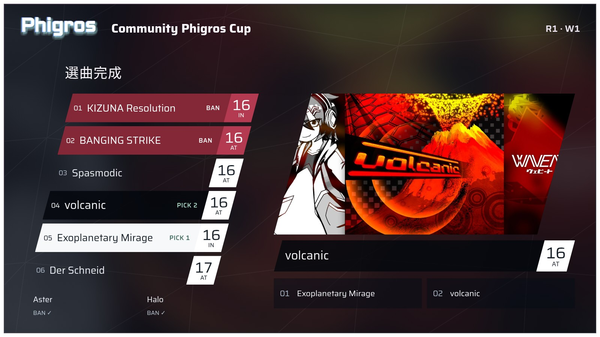
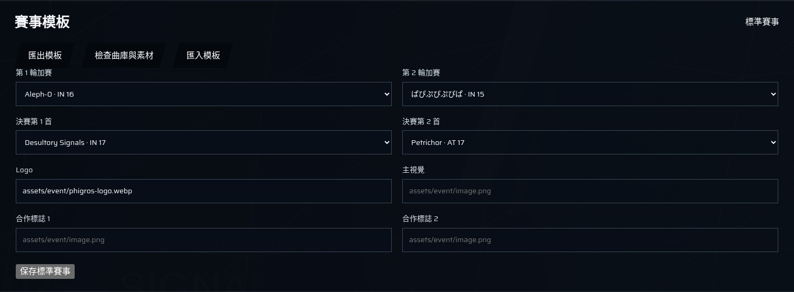
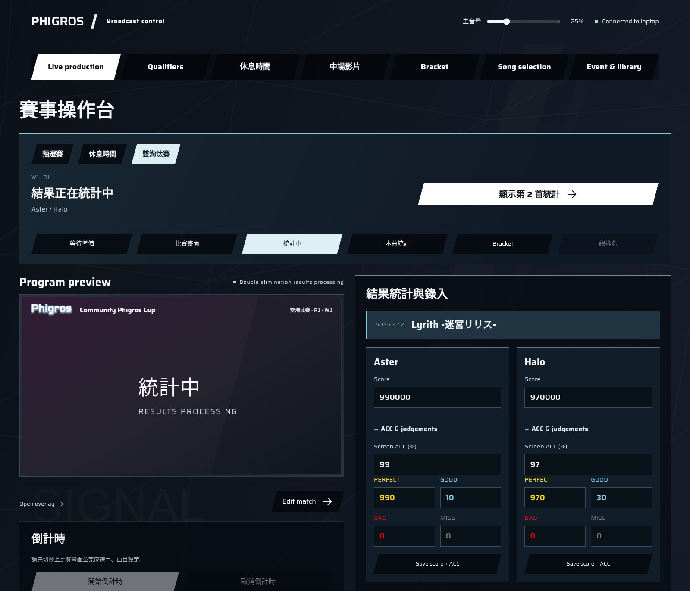
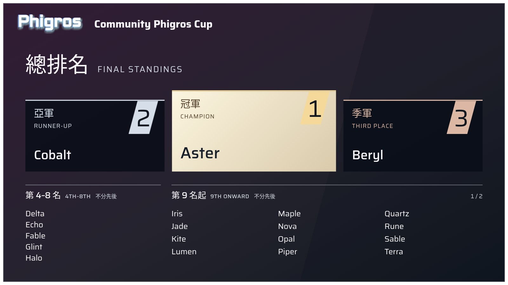

# Phigros Tournament Broadcast

通过一台本地服务器，操作 Phigros 预选赛、八人双淘汰赛及 OBS 直播图层。

[](https://github.com/VivoWalker/Phigros-Tournament-Boardcast/actions/workflows/test.yml)

[English](README.md) · [繁體中文](README.zh-TW.md) · **简体中文**



*图片为实际程序截图，使用虚构选手。操作界面目前混合使用英文及繁体中文。*

[快速开始](#快速开始) · [比赛操作流程](#比赛操作流程) · [OBS 设置](#obs-设置) · [文档入口](#文档入口)

## 功能与范围

- **直播导播：**通过操作台切换等待、曲目公布、比赛、统计、赛果、中场休息及总排名。
- **工作分工：**主控、记分员和主持人各有独立面板、配对码及权限。
- **比赛流程：**三首预选课题、晋级线同分加赛、六首候选曲、选手 BAN 曲、两首制对局及分阶段 ACC 判定。
- **配置复用：**可更换曲库、预选／加赛／决赛曲、品牌图片，并导入或导出赛事模板。
- **统一音量：**乐曲预览、背景音乐和视频共用主音量；工作人员预览保持静音。
- **局域网操作：**支持电脑、平板和 iPad。安装完成后，播出使用项目附带的本地素材，不依赖云服务或 CDN。

通用模式仍属于**实验版本**，沿用当前计分规则及八人双淘汰赛架构；尚不支持任意人数的双淘汰树、自定义计分公式或可编排的特效插件。

## 快速开始

### 1. 安装并启动

安装 **Node.js 24.22.1 或更新的 24.x 版本**及 Git。负责直播的电脑还需安装 OBS Studio。

```sh
git clone https://github.com/VivoWalker/Phigros-Tournament-Boardcast.git
cd Phigros-Tournament-Boardcast
npm ci
npm start -- --standard --data-dir ./data-community
```

保持终端开启。启动后会显示服务器的局域网地址，以及主控、记分员、主持人**三组不同的配对码**。在服务器终端按 Ctrl+C 可结束服务。

> 新比赛请使用 `--standard`。直接执行 `npm start` 时，新目录仍采用 ACAHKU 预设。启动参数只初始化空目录，不会转换已有赛事存档。

### 2. 打开面板

| 角色 | 本地地址 | 可操作内容 |
| --- | --- | --- |
| 主控 | http://localhost:3000/control/ | 赛事设置、导播、计分、确认赛果及备份 |
| 记分员 | http://localhost:3000/scorekeeper/ | 当前选手及曲目／课题的成绩录入 |
| 主持人 | http://localhost:3000/host/ | 常规场次：抽六首候选、P1／P2 BAN、抽两首比赛曲 |
| OBS Browser Source | http://localhost:3000/overlay/live.html | 跟随主控选择的直播场景 |

使用另一台电脑或 iPad 时，将 `localhost` 换成服务器的局域网 IP。设备需连接同一网络，并使用相应角色的配对码。`PORT` 默认为 `3000`；同时运行另一个服务器时请使用不同端口。

## 比赛操作流程

### 1. 准备赛事与曲库

在 **Event & library** 保存赛名、主办方和日期，再新增或编辑曲库。每个谱面包含曲名、难度、等级、本地曲绘路径及可选的预览音频。

在 **賽事模板** 选择两轮预选加赛曲及两首固定决赛曲，并将这些预留曲目排除在常规抽曲池之外。填写 Logo、主视觉和合作标志路径后，按 **保存標準賽事**。操作名称保留界面中的繁体写法，便于查找。



为每轮／组预选赛选择三首课题。开赛前执行 **檢查曲庫與素材**。完整八人赛程建议至少准备 **30 首不同的常规曲目**，另留加赛余量。检查会报告缺失路径及曲库数量，但不保证足以应付无限次加赛。

曲绘放在 `public/assets/`，预览音频放在 `public/assets/song-preview/`。字段填写 `assets/song/cover.png` 这类相对路径，不接受外部网址。将模板交给另一台电脑时，也需复制实际素材文件。

### 2. 登记选手并选择预选方案

在 **Qualifiers** 输入名单，分配或抽选选手编号。请先完成曲目和模板配置，再选择方案：

- **Plan A：**20 人及以下。第一轮四人晋级，复活赛再取四人。
- **Plan B：**超过 20 人。按选手编号分为奇数／偶数两组，各取四人。
- **Auto：**按名单人数选择方案。

选择方案后，通用模板会锁定；已有分数或比赛历史时也不能替换。需要另一套赛事配置时，请使用新目录。

### 3. 进行预选赛

在 **Live production** 选择当前批次，依次进入等待、比赛及统计。保存每位选手的三首分数、Perfect／Good／Bad／Miss，以及**游戏显示的三首 Challenge 官方总分**。

确认晋级前处理影响晋级线的同分。加赛依次显示隐藏曲目的选手准备画面、含音频预览的曲目公布、等待、比赛、统计及赛果确认。不影响晋级的同分不会阻挡推进。

### 4. 双淘汰赛抽曲及比赛

常规双淘汰赛由主控先选定当前场次，主持人再进行：

1. 按 **Draw 6 candidates** 抽出六首候选曲。
2. 使用 **P1 Ban / P2 Ban** 为双方各 BAN 一首。
3. 按 **Draw 2 match songs** 抽选两首比赛曲。

总决赛从已保存的配置公布曲目。常规抽曲时，剩余曲目会滚动高亮，先抽出并预览第一首，再抽出并预览第二首。公布结束后，由主控进入准备画面。主持人不能切换场次／场景、录分或确认赛果。



每首歌依次进行 **等待 → 比赛 → 统计中 → 本曲统计**。按面板要求保存分数、判定数和 ACC，确认整轮赛果后推进对阵。总分相同时，先显示同分，再公布平均 ACC，最后显示判定或进入加赛。

### 5. 中场休息与总排名

**休息時間** 显示休息画面。标准模式的 **中場影片** 可上传 MP4／WebM，或设置本地视频路径；播放一次后会返回休息画面。替换素材应先做好音量平衡，主音量控制只调整播放增益，不会自动规范化文件响度。

确认总决赛后，按 **公布賽事總排名**。冠、亚、季军有独立名次，其余选手分别列入不分先后的第 4–8 名及第 9 名起分组；较长的名单会自动翻页。



## OBS 设置

1. 在 OBS 为每位选手新增独立的 **Video Capture Device／摄像头**来源。当前单画面采用 **4:3、960×720、30 fps**。完整的 1280×720 是 16:9；请选择或裁切出摄像头实际的 4:3 画面后再对齐。
2. 在视频来源上方新增一个 **Browser Source**，网址设为 `http://localhost:3000/overlay/live.html`，尺寸为 **1920×1080**。OBS 在另一台电脑时，请改用服务器的局域网 IP。
3. 关闭 **Shutdown source when not visible** 及 **Refresh browser when scene becomes active**。现有 Browser Source 会跟随主控切换，无需重新加载。
4. 在 **Live production → 畫面顯示** 选择 **單畫面 · Webcam 4:3**。预选赛有三个选手槽，双淘汰赛有两个；将 OBS 视频对齐透明窗口，并完成来源名称及人工核对。
5. 为正式 Browser Source 开启 **Control audio via OBS**。额外的图层来源请加上 `?audio=0`，避免重复播放；内嵌工作人员预览已自动静音。

本系统提供图层和来源核对表。视频由 OBS 采集，来源安排及 OBS 场景需手动切换。可选的采集卡／手元双画面及对齐细节见[操作手册](docs/acahku-2026.md#obs-setup)。

## 模板、存档与预设

| 类型 | 用途 | 包含内容 |
| --- | --- | --- |
| **赛事模板** | 开赛前复用配置 | 赛事信息、曲库、预选／加赛／决赛曲、品牌图片及中场设置 |
| **状态备份** | 恢复或继续比赛 | 已保存的赛事状态，包含名单、分数、抽曲和对阵进度 |

在 **賽事模板 → 匯出模板** 下载配置，并在新比赛选择预选方案前导入。模板不含选手姓名、成绩、历史、配对码或播放进度。**两种 JSON 都不内嵌媒体文件**，需单独复制或重新上传素材。

完整迁移到另一台电脑前，先停止服务器，再保存整个赛事目录，包含已上传视频和配对信息。每场比赛请使用独立的 `data-名称/` 目录，此命名方式已被 Git 忽略。主控的 **Export state backup** 及恢复工具用于保存和恢复进度。

| 预设 | 总决赛 | 呈现方式 |
| --- | --- | --- |
| **标准模式**（`--standard`） | 两首自定义曲目 | 通用曲目公布与赛果，不需要 ACAHKU 专属决胜演出 |
| **ACAHKU 2026**（直接启动） | 三首曲目 | 原有决胜曲 PV、侵入及净化演出 |

更多配置细节见[通用赛事设置](docs/reusable-events.md)（繁体中文）；[ACAHKU 操作手册](docs/acahku-2026.md)保留原比赛的专属流程。

## 常见问题

| 现象 | 检查方式 |
| --- | --- |
| 服务器拒绝启动 | 执行 `node --version`，安装受支持的 24.x 版本。更新 npm 包不会更新 Node.js。 |
| 平板无法连接 | 使用服务器的局域网 IP，确认同一网络及本地防火墙端口；访客 Wi-Fi 可能隔离设备。 |
| 正式画面没有声音 | 检查主音量和 OBS 混音器。若出现音频启用提示，可通过 OBS **Interact** 点击；工作人员预览本来就会静音。 |
| 比赛窗口没有视频 | 在 OBS 的 Browser Source 下方新增并对齐视频来源；网页程序不会采集摄像头。 |
| 模板不能修改 | 已选择预选方案或已有比赛历史，配置已锁定。另一套配置请使用新赛事目录。 |

## 文档入口

- [English](README.md)／[繁體中文](README.zh-TW.md)：同等内容的启动与操作说明。
- [通用赛事设置](docs/reusable-events.md)：模板、预留曲目、素材及配置锁定；繁体中文。
- [完整操作手册](docs/acahku-2026.md)：OBS 对齐、来源核对、备份、修正及 ACAHKU 预设；以英文为主。
- [人工测试存档](test/manual-saves/README.md)：同分、晋级、视频等关键节点。
- [截图来源](docs/images/README.md)：虚构数据及重新截取图片的方法。

## 开发与验证

无需前端构建。Express 和 Socket.IO 直接提供项目附带的 HTML、CSS、JavaScript、字体和媒体。

```sh
npm test
```

可选的媒体及浏览器检查需先安装 Python 工具和 Chromium：

```sh
python3 -m pip install -r requirements-test.txt
python3 -m playwright install chromium
npm run test:python
npm run test:browser:smoke
```

可用 `CHROME_BINARY` 指定已安装的 Chromium。测试使用临时赛事数据，报告写入 `test-results/`。人工检查可先执行 `npm run test:manual -- --list`。

请针对 `main` 开启 PR，修复附上复现步骤，调整界面时更新截图，并保持英文、繁体及简体说明同步。

## 项目来源与素材

本项目衍生自 [ACAHKU Phigros Competition 2026](https://github.com/VivoWalker/ACAHKU-Phigros-Competition-2026)，保留其 Git 历史及原比赛预设，目前以独立仓库维护。

素材来源说明保留在：[曲绘](public/assets/song/song-list-2026/README.md)、[乐曲预览](public/assets/song-preview/README.md)、[背景音乐](public/assets/bgm/README.md)及[选曲音效](public/assets/sfx/README.md)。
