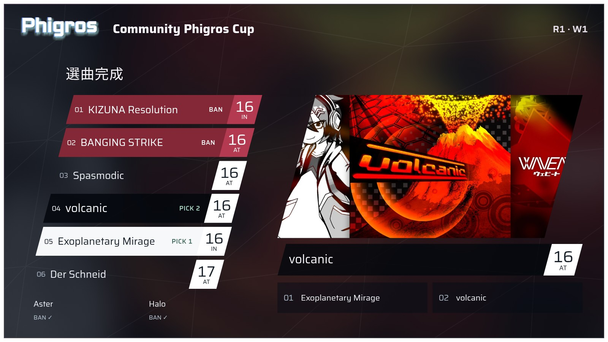
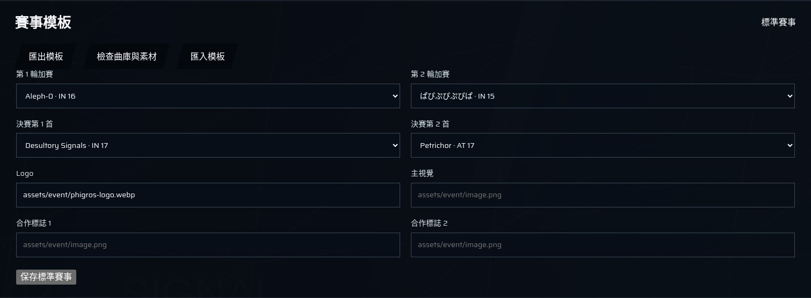
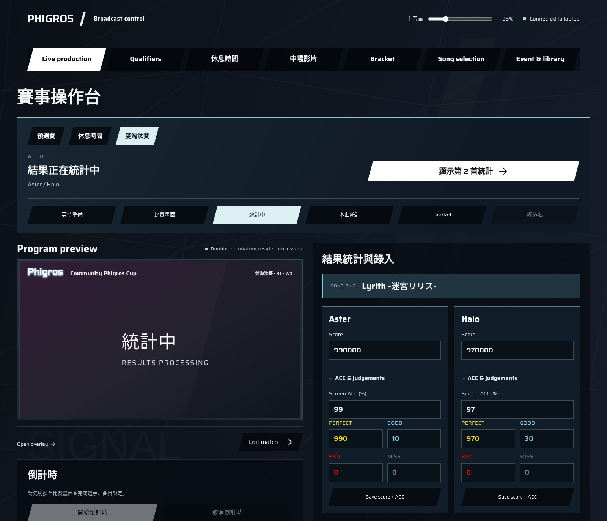
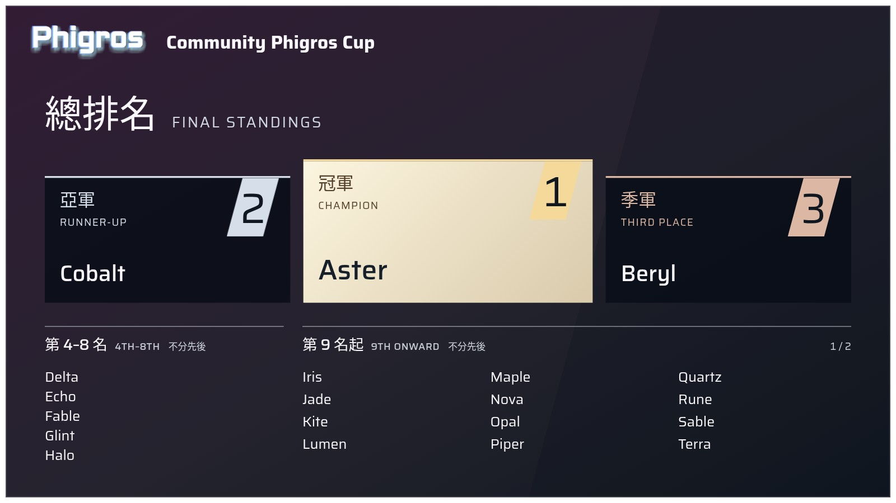

# Phigros Tournament Broadcast

透過一台本機伺服器，操作 Phigros 預選賽、八人雙淘汰賽及 OBS 直播圖層。

[](https://github.com/VivoWalker/Phigros-Tournament-Boardcast/actions/workflows/test.yml)

[English](README.md) · **繁體中文** · [简体中文](README.zh-CN.md)



*圖片為實際程式截圖，使用虛構選手。操作介面目前混合使用英文及繁體中文。*

[快速開始](#快速開始) · [操作流程](#操作流程) · [OBS 設定](#obs-設定) · [文件入口](#文件入口)

## 功能與範圍

- **直播導播：**透過操作台切換等待、曲目公布、比賽、統計、賽果、中場休息及總排名。
- **工作分工：**主控、計分員和主持人各有獨立面板、配對碼及權限。
- **賽事流程：**三首預選課題、晉級線同分加賽、六首候選曲、選手 BAN 曲、兩首制對局及分階段 ACC 判定。
- **配置複用：**可更換曲庫、預選／加賽／決賽曲、品牌圖片，並匯入或匯出賽事模板。
- **統一音量：**樂曲預覽、背景音樂和影片共用主音量；工作人員預覽保持靜音。
- **區域網路操作：**支援電腦、平板和 iPad。安裝完成後，播出使用隨專案提供的本機素材，不依賴雲端服務或 CDN。

通用模式仍屬**實驗版本**，沿用目前計分規則及八人雙淘汰賽架構；尚不支援任意人數的雙淘汰樹、自訂計分公式或可編排的特效插件。

## 快速開始

### 1. 安裝並啟動

安裝 **Node.js 24.22.1 或更新的 24.x 版本**及 Git。負責直播的電腦另需安裝 OBS Studio。

```sh
git clone https://github.com/VivoWalker/Phigros-Tournament-Boardcast.git
cd Phigros-Tournament-Boardcast
npm ci
npm start -- --standard --data-dir ./data-community
```

保持終端開啟。啟動後會顯示伺服器的區域網路網址，以及主控、計分員、主持人**三組不同的配對碼**。在伺服器終端按 Ctrl+C 可結束服務。

> 新比賽請使用 `--standard`。直接執行 `npm start` 時，新資料夾仍採用 ACAHKU 預設。啟動參數只初始化空資料夾，不會轉換已有賽事存檔。

### 2. 開啟面板

| 角色 | 本機網址 | 可操作內容 |
| --- | --- | --- |
| 主控 | http://localhost:3000/control/ | 賽事設定、導播、計分、確認賽果及備份 |
| 計分員 | http://localhost:3000/scorekeeper/ | 當前選手及曲目／課題的成績錄入 |
| 主持人 | http://localhost:3000/host/ | 常規場次：抽六首候選、P1／P2 BAN、抽兩首比賽曲 |
| OBS Browser Source | http://localhost:3000/overlay/live.html | 跟隨主控選擇的直播場景 |

使用另一台電腦或 iPad 時，將 `localhost` 換成伺服器的區域網路 IP。裝置需連到同一網路，並使用相應角色的配對碼。`PORT` 預設為 `3000`；同時運行另一個伺服器時請使用不同連接埠。

## 操作流程

### 1. 準備賽事與曲庫

在 **Event & library** 儲存賽名、主辦方和日期，再新增或編輯曲庫。每個譜面包含曲名、難度、等級、本機曲繪路徑及可選的預覽音訊。

在 **賽事模板** 選擇兩輪預選加賽曲及兩首固定決賽曲，並將這些預留曲目排除於常規抽曲池之外。填寫 Logo、主視覺和合作標誌路徑後，按 **保存標準賽事**。



為每輪／組預選賽選擇三首課題。開賽前執行 **檢查曲庫與素材**。完整八人賽程建議至少準備 **30 首不同的常規曲目**，另留加賽餘量。檢查會回報缺失路徑及曲庫數量，但不保證足以應付無限次加賽。

曲繪放在 `public/assets/`，預覽音訊放在 `public/assets/song-preview/`。欄位填寫 `assets/song/cover.png` 這類相對路徑，不接受外部網址。將模板交給另一台電腦時，也需複製實際素材檔案。

### 2. 登錄選手並選擇預選方案

在 **Qualifiers** 輸入名單，分配或抽選選手編號。請先完成曲目和模板配置，再選擇方案：

- **Plan A：**20 人或以下。第一輪四人晉級，復活賽另取四人。
- **Plan B：**超過 20 人。按選手編號分為奇數／偶數兩組，各取四人。
- **Auto：**按名單人數選擇方案。

選擇方案後，通用模板會鎖定；已有分數或賽事歷史時也不能替換。需要另一套賽事配置時，請使用新資料夾。

### 3. 進行預選賽

在 **Live production** 選擇當前批次，依序進入等待、比賽及統計。保存每位選手的三首分數、Perfect／Good／Bad／Miss，以及**遊戲顯示的三首 Challenge 官方總分**。

確認晉級前處理影響晉級線的同分。加賽依序顯示隱藏曲目的選手準備畫面、含音訊預覽的曲目公布、等待、比賽、統計及賽果確認。不影響晉級的同分不會阻擋推進。

### 4. 雙淘汰賽抽曲及比賽

常規雙淘汰賽由主控先選定當前場次，主持人再進行：

1. 按 **Draw 6 candidates** 抽出六首候選曲。
2. 使用 **P1 Ban / P2 Ban** 為雙方各 BAN 一首。
3. 按 **Draw 2 match songs** 抽選兩首比賽曲。

總決賽從已保存的配置公布曲目。常規抽曲時，剩餘曲目會滾動高亮，先抽出並預覽第一首，再抽出並預覽第二首。公布結束後，由主控進入準備畫面。主持人不能切換場次／場景、錄分或確認賽果。



每首歌依序進行 **等待 → 比賽 → 統計中 → 本曲統計**。依面板要求保存分數、判定數和 ACC，確認整輪賽果後推進對陣。總分相同時，先顯示同分，再公布平均 ACC，最後顯示判定或進入加賽。

### 5. 中場休息與總排名

**休息時間** 顯示休息畫面。標準模式的 **中場影片** 可上傳 MP4／WebM，或設定本機影片路徑；播放一次後會返回休息畫面。替換素材應先做好音量平衡，主音量控制只調整播放增益，不會自動正規化檔案響度。

確認總決賽後，按 **公布賽事總排名**。冠、亞、季軍有獨立名次，其餘選手分別列入不分先後的第 4–8 名及第 9 名起群組；較長的名單會自動換頁。



## OBS 設定

1. 在 OBS 為每位選手新增獨立的 **Video Capture Device／攝影機**來源。現行單畫面採用 **4:3、960×720、30 fps**。完整的 1280×720 是 16:9；請選擇或裁切出攝影機實際的 4:3 畫面後再對齊。
2. 在影像來源上方新增一個 **Browser Source**，網址設為 `http://localhost:3000/overlay/live.html`，尺寸為 **1920×1080**。OBS 在另一台電腦時，請改用伺服器的區域網路 IP。
3. 關閉 **Shutdown source when not visible** 及 **Refresh browser when scene becomes active**。現有 Browser Source 會跟隨主控切換，不需重新載入。
4. 在 **Live production → 畫面顯示** 選擇 **單畫面 · Webcam 4:3**。預選賽有三個選手槽，雙淘汰賽有兩個；將 OBS 影像對齊透明視窗，並完成來源名稱及人工核對。
5. 為正式 Browser Source 開啟 **Control audio via OBS**。額外的圖層來源請加上 `?audio=0`，避免重複播放；內嵌工作人員預覽已自動靜音。

本系統提供圖層和來源核對表。影像由 OBS 擷取，來源安排及 OBS 場景需人工切換。可選的擷取卡／手元雙畫面及對齊細節見[操作手冊](docs/acahku-2026.md#obs-setup)。

## 模板、存檔與預設

| 類型 | 用途 | 包含內容 |
| --- | --- | --- |
| **賽事模板** | 開賽前複用配置 | 賽事資料、曲庫、預選／加賽／決賽曲、品牌圖片及中場設定 |
| **狀態備份** | 恢復或繼續比賽 | 已保存的賽事狀態，包含名單、分數、抽曲和對陣進度 |

在 **賽事模板 → 匯出模板** 下載配置，並在新賽事選擇預選方案前匯入。模板不含選手姓名、成績、歷史、配對碼或播放進度。**兩種 JSON 都不內嵌媒體檔案**，需另行複製或重新上傳素材。

完整移往另一台電腦前，先停止伺服器，再保存整個賽事資料夾，包含已上傳影片和配對資訊。每場比賽請使用獨立的 `data-名稱/` 資料夾，此命名方式已被 Git 忽略。主控的 **Export state backup** 及恢復工具用於保存和恢復進度。

| 預設 | 總決賽 | 呈現方式 |
| --- | --- | --- |
| **標準模式**（`--standard`） | 兩首自訂曲目 | 通用曲目公布與賽果，不需要 ACAHKU 專屬決勝演出 |
| **ACAHKU 2026**（直接啟動） | 三首曲目 | 原有決勝曲 PV、侵入及淨化演出 |

更多配置細節見[通用賽事設定](docs/reusable-events.md)；[ACAHKU 操作手冊](docs/acahku-2026.md)保留原賽事的專屬流程。

## 常見問題

| 現象 | 檢查方式 |
| --- | --- |
| 伺服器拒絕啟動 | 執行 `node --version`，安裝受支援的 24.x 版本。更新 npm 套件不會更新 Node.js。 |
| 平板無法連線 | 使用伺服器的區域網路 IP，確認同一網路及本機防火牆連接埠；訪客 Wi-Fi 可能隔離裝置。 |
| 正式畫面沒有聲音 | 檢查主音量和 OBS 混音器。若出現音訊啟用提示，可透過 OBS **Interact** 點擊；工作人員預覽本來就會靜音。 |
| 比賽視窗沒有影像 | 在 OBS 的 Browser Source 下方新增並對齊影像來源；網頁程式不會擷取攝影機。 |
| 模板不能修改 | 已選擇預選方案或已有賽事歷史，配置已鎖定。另一套配置請使用新賽事資料夾。 |

## 文件入口

- [English](README.md)／[简体中文](README.zh-CN.md)：同等內容的啟動與操作說明。
- [通用賽事設定](docs/reusable-events.md)：模板、預留曲目、素材及配置鎖定。
- [完整操作手冊](docs/acahku-2026.md)：OBS 對齊、來源核對、備份、修正及 ACAHKU 預設；以英文為主。
- [人工測試存檔](test/manual-saves/README.md)：同分、晉級、影片等重要節點。
- [截圖來源](docs/images/README.md)：虛構資料及重新擷取圖片的方法。

## 開發與驗證

無需前端建置。Express 和 Socket.IO 直接提供隨專案附帶的 HTML、CSS、JavaScript、字型和媒體。

```sh
npm test
```

可選的媒體及瀏覽器檢查需先安裝 Python 工具和 Chromium：

```sh
python3 -m pip install -r requirements-test.txt
python3 -m playwright install chromium
npm run test:python
npm run test:browser:smoke
```

可用 `CHROME_BINARY` 指定已安裝的 Chromium。測試使用臨時賽事資料，報告寫入 `test-results/`。人工檢查可先執行 `npm run test:manual -- --list`。

請針對 `main` 開啟 PR，修復附上重現步驟，調整介面時更新截圖，並保持英文、繁體及簡體說明同步。

## 專案來源與素材

本專案衍生自 [ACAHKU Phigros Competition 2026](https://github.com/VivoWalker/ACAHKU-Phigros-Competition-2026)，保留其 Git 歷史及原賽事預設，目前以獨立倉庫維護。

素材來源說明保留於：[曲繪](public/assets/song/song-list-2026/README.md)、[樂曲預覽](public/assets/song-preview/README.md)、[背景音樂](public/assets/bgm/README.md)及[選曲音效](public/assets/sfx/README.md)。
